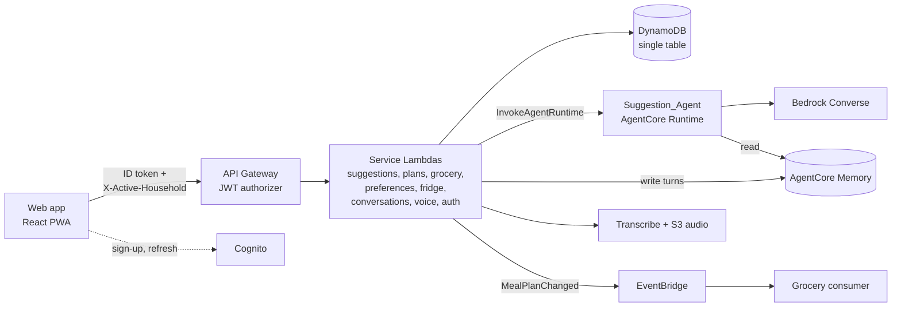

# Sous architecture overview

This is a map of how the pieces fit together. For the layer summary see the [README](../README.md#architecture). For the full reasoning, requirements and correctness properties see the [design document](../.kiro/specs/meal-planner/design.md). For stack resources, IAM and context keys see [infra/README.md](../infra/README.md).

## System diagram

## Request path

The web app sends the Cognito ID token and the selected household in the `X-Active-Household` header. API Gateway verifies the token before any Lambda runs. Each service Lambda then re-checks household membership with a strongly consistent read on every request (`src/services/shared/authorization`). A missing header, a malformed id and a household the caller is not in all return the same `403 NOT_A_MEMBER`, so the API never reveals which households exist.

## Code layers

In `src/`, dependencies point downward only:

| Layer | Path | Role |
|---|---|---|
| Services | `src/services/<name>/` | One Lambda per service: `lambda.ts` (entry point) calls the HTTP handler (parsing, error mapping), which calls the service class (orchestration) |
| Agent client | `src/agent/` | Wire contract with the agent (`payload.ts`, `responses.ts`), the Runtime client and the AgentCore Memory client |
| Data | `src/data/` | Key construction (`keys.ts`), DynamoDB access (`tableClient.ts`) and the household-scoped repository |
| Domain | `src/domain/` | Pure, deterministic logic and types: exclusions, grocery consolidation, units, presets, invitations. No I/O |

`agent/` and `web/` reuse `src/domain` (the web app through the `@sous/domain` alias), and `agent/` also reuses the `src/agent` payload and response modules. The agent validates its own output with the same parser the Lambdas use, so there is one definition of the wire contract.

## Design rules worth knowing before you change anything

- **The household is the tenant.** Every tenant record has the partition key `HH#{householdId}`, and ids containing `#` are rejected before they reach a key, so one id cannot forge another household's key. Request paths never scan the table. GSIs are eventually consistent and are never used for authorization decisions.
- **Hard rules are code, soft preferences are the model.** Dietary constraints and excluded ingredients live in the structured preference profile and are enforced deterministically in Lambda. Free-form likes and dislikes learned from chat live in AgentCore Memory (namespaced by `householdId` only) and only nudge the model. If that memory is unavailable, generation continues without it.
- **Deterministic logic stays out of the agent.** Grocery consolidation, fridge subtraction, preset validation and invitation state are pure functions in `src/domain`. The agent makes one structured-output model call per request (per chunk for plans) plus at most one repair call. It has no tool loop.
- **Failures leave no partial state.** The suggestion service validates first, calls the agent against a time budget, and writes results in one transaction only if the budget has not run out. Suggestions use a 10 s budget. Plans stay synchronous inside the 30 s gateway limit by generating in parallel chunks of at most 4 days (see the [README notes](../README.md#notes)).
- **Sign-in is the one server-side auth path.** `POST /auth/login` goes through the backend so the lockout (5 failures in 15 minutes) applies. Sign-up, confirmation and token refresh call Cognito directly from the browser, since the app client is public.
- **Voice is review-first.** The browser records 16 kHz mono PCM and uploads it. ffmpeg in the Voice Lambda is only a fallback for WebM/MP4. A transcript is never applied until the user has reviewed and confirmed it.
